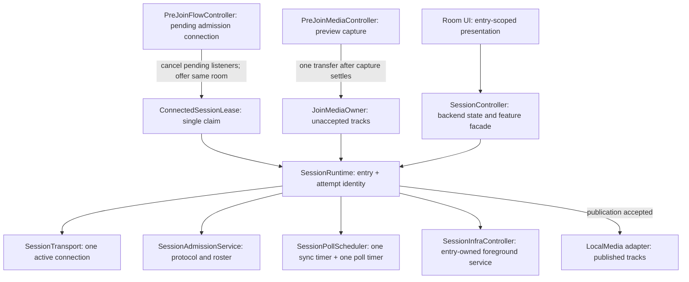

# Sessions architecture contract

This document describes the implemented ownership model through Phase 6 and records the remaining infrastructure compatibility boundaries. Historical phase notes below distinguish completed changes from remaining SDK migration work. Keep PR #190's `LocalMedia`/`RoomMedia` abstractions, client-side cooperative admission, Safari track reuse, and video rendering safeguards.

## Ownership matrix

| Concern | Authority / canonical owner | Current owner(s) and allowed mutation | Observers, lifetime, persistence |
|---|---|---|---|
| Connection lifecycle | Session connection coordinator; LiveKit is transport truth | `SessionRuntime` alone owns active attempts and transport lifetime; `SessionController` reconciles feature state; the adapter owns SDK resources | Screens observe; connection scoped to one session; never persisted |
| Server room state | Versioned backend room-state stream, reduced into `SessionRoomState` | `SessionStateReducer` is the client projection; only accepted server events mutate it | Controllers/widgets observe projection; reset on connection identity change; no local persistence |
| Turn order | Backend `RoomState` | `SessionTurnService` issues commands; reducer accepts monotonic versions | Widgets observe selectors; no local order authority |
| Participant presence/metadata | `SessionTransport` | `SessionController` maintains its immutable `ParticipantInfo` projection; admission derives visibility | Widgets observe; no independent presence authority |
| Capture | Local device / `LocalMedia` | `PreJoinMediaController` before handoff; room media owner after handoff; no widget capture ownership | Preview/room renderers observe; device scoped then session scoped; release exactly once |
| Publication | LiveKit transport, mediated by `RoomMedia`/adapter | `LiveKitLocalMedia` is the only publication boundary | Session controller and UI observe; release before disconnect |
| Device selection | Local device preferences/provider | `SessionDeviceController` may select; media adapter applies | Controls observe; device lifetime; persistence only where explicit user preference exists |
| Admission decisions | Cooperative client-side admission protocol | Admission controllers and keeper actions mutate decisions; panel is presentation only | Waiting/admitted/declined UI observes; session scoped, recoverable from protocol state; no backend authority implied |
| Admitted roster | Admission protocol projection | `KeeperAdmissionRoster` currently owns a projection; must not become an independent competing room roster | Admission UI observes; reset per session |
| Chat | `SessionChatService` | Validates/encodes/decodes, deduplicates, sends, and appends immutable arrival-ordered messages | Read-only `sessionChatMessagesProvider` / `sessionMessagesProvider`; entry-local, no persistence |
| Reactions | Entry-owned `SessionReactionBuffer` | `SessionReactionsService` adapts typed packets; scoped `EmojiReactions` projects the buffer and presents it | Per-entry throttle and maximum 10 pending entries; immutable snapshots, no persistence |
| Prompts | Client session domain/controller | `SessionPromptsController` mutates prompt state from allowed actions/events | Prompt widgets observe; session scoped |
| Panel visibility | Presentation state | Each active session presentation scope owns its own panel selection/visibility | Widgets only; reset with presentation/session; never server state |
| Timers | Domain-specific timer owner (admission or turn) | Owning controller creates/cancels; widgets render remaining state | Session scoped; cancel on terminal transition; no persistence unless protocol defines it |
| Notifications and cues | Presentation effect owners | `SessionStatusEffects`, `SessionDeviceEffects`, `SessionEnvironmentEffects`; shared queue owned by `SessionPresentationEffects` | Registered once per mounted entry; cancel/dismiss on replacement or disposal; no domain resources |
| Errors | Operation/connection owner creates typed error state | Controllers translate boundary failures; UI renders/retries via intents | Scoped to operation/session; clear only through defined recovery or reset |

A derived view, selector, or immutable projection is legitimate when it has one upstream authority and cannot independently accept writes. Two writable copies of participants, connection status, room state, or admission state are a defect.

## Dependency and SDK rules

Dependencies point inward: widgets depend on view state and intent interfaces; controllers depend on domain contracts; adapters implement device, backend, and transport boundaries. Screens may not own domain services whose work must survive screen replacement. Riverpod scopes must match the session identity and lifetime; a provider's auto-dispose behavior is not itself proof that a LiveKit resource has been released.

LiveKit SDK types belong in `features/sessions/media/` adapters and narrowly documented transport integration code. Domain controllers should use `LocalMedia`/`RoomMedia` contracts. Existing pre-join capture controller is an explicit temporary exception until Phase 4 completes; do not expand that exception.

## Lifecycle contracts

Connection: `idle -> joining -> connected -> leaving -> ended`; failures enter recoverable `failed` and may retry. Repeated join for the same connection while joining or connected returns/awaits the same operation. `connected` is observable only after required initialization (room listeners, canonical initial state, and media ownership setup) completes. A connection generation/session identity gates every async completion; stale generations cannot publish state into a newer session.

Admission: `waiting -> admitted | declined`; recovery/reconnect reconstructs client state from protocol events. The panel may mount/unmount without starting or stopping admission. Admission is cooperative and remains client-side; it does not guarantee server-side access control.

Pre-join media has one owner at a time. Transfer to the room occurs once after successful join preparation; failed join retains or releases according to the explicit failure path. Release is idempotent. Teardown order: stop accepting intents; invalidate session generation; cancel timers and subscriptions/listeners; release published tracks/capture through media owner; disconnect transport; dispose controllers/providers. Every cleanup step tolerates repetition.

## Enforceable invariants and phase gaps

1. One authoritative owner per resource; projections are read-only. **Gap:** overlapping controller responsibilities; Phases 2–5.
2. One canonical server room-state source; accepted version never rolls back. **Gap:** verify/strengthen reducer and stream contract in Phase 2.
3. Concurrent same-connection joins deduplicate; success waits for required initialization. **Implemented in Phase 5:** runtime single-flight joining waits for initialization and media publication.
4. Pre-join capture transfers exactly once. **Implemented in Phase 5:** pre-join rejects repeated capture claims; `JoinMediaReceipt` tracks only unaccepted tracks and publication decisions.
5. Cleanup is idempotent; stale/disposed sessions cannot mutate newer sessions. **Implemented in Phase 5:** scoped attempt validity, serialized cleanup, and entry-owned infrastructure prevent replacement races.
6. Admission is independent of panel visibility and remains cooperative/client-side. Existing protocol tests cover recovery; preserve and extend in Phase 3.
7. Each active session has isolated presentation state. **Implemented in Phase 3:** presentation and chat UI state depend on the entry scope.
8. Widgets do not own domain services that outlive them. **Implemented for admission in Phase 2:** the runtime retains its lifetime in Phase 5; feature separation continues in Phase 6.
9. Media capture/publication goes through media abstractions, preserving Safari reuse and video safeguards. Existing guard checks capture calls; broaden only with reliable checks in Phase 4.

## Riverpod and lifetime

The session scope is a container for dependencies and presentation projections, not a universal owner. Session identity must key the scope. Providers that own subscriptions/controllers must dispose them; root/navigation ownership must retain a session service when it outlives a route. Generated `@riverpod` providers are preferred. Generated provider code is not an architectural authority; inspect its dependencies and disposal behavior alongside annotations.

## Phases 2–6 issues

- **Phase 2 (implemented):** session-owned admission and roster recovery.
- **Phase 3 (implemented):** entry-scoped presentation and room-owned transient routes.
- **Phase 4 (partially implemented on this branch):** complete the remaining SDK integrations listed below; preserve the runtime ownership boundary.
- **Phase 5 (implemented):** runtime attempts, single-flight joining, lease adoption, coordinated cleanup, and media/polling ownership.
- **Phase 6 (implemented):** typed packet routing, feature-owned chat/turn/moderation/presence, explicit command failure behavior, deterministic reduction, and separate presentation effect lifetimes.

## Phase 2 admission implementation

`SessionController` retains `SessionAdmissionService` independently of the overlay. Its state listener drives attachment; connection teardown awaits admission detachment before releasing the room. Final provider disposal closes admission and fences late callbacks. Protocol controllers and recovery stores retain their existing formats and client-side semantics. The overlay observes service state and renders recovery stores; it no longer constructs transports, owns protocol subscriptions, or installs a moderation callback.

Moderation persists a write-ahead removal intent before calling the backend. Initial storage failure prevents that call. Confirmed backend success synchronously revokes the active controller roster and its media/visibility projection before any further storage await. The service then records the committed outcome, persists the canonical roster including its revocation tombstone, and finally clears the journal. Failed final writes retain the live restriction and block another removal until admission recovery completes. An owner-checked persistence callback prevents a superseded service from clearing its journal after saving a different roster.

The journal lives in `SessionAdmissionPreferences` under `session_admission_revocations:` plus the JSON-encoded session slug/Keeper identity pair. It records `intent`, `committed`, or `rejected` per identity; the previous list format is read as committed for compatibility. Journal operations serialize across service instances during entry handoff, with completed queue entries released. The existing Keeper roster storage key persists an optional `revoked` list alongside its members/readiness/revision. This is client-local recovery data, not a packet or backend authorization change.

A definite backend rejection leaves admission intact, records rejection before cleanup, and propagates the rejection. If cleanup fails, recovery is required but the participant remains eligible in the live session. A timeout, network error, or server failure is an unknown outcome: the durable intent remains, automatic decisions/removal retries are blocked, and the local visibility/media projection quarantines the identity. Re-entry conservatively restores that pending state. Retry recovery can finish known commits/rejections but cannot infer an unknown backend result. The recovery panel offers explicit verified-outcome confirmation through `reconcileRemoval`; it never sends another backend removal. Removal confirmation uses the moderation deadline instead of the generic ten-second UI timeout, so a pending commit cannot produce a competing retry prompt. If every write after a rejection fails, a restart retains only the original intent and requires verification again.

Recovery preserves known committed/rejected outcomes across transport replacement for the same Keeper, even if the journal outcome update failed. Keeper changes fence that in-memory knowledge from the next owner. Recovery always awaits a replacement roster write, even if an earlier failed write already mutated its in-memory store. Only then may it clear known records. Durable tombstones stop automatic re-admission across reconnect and re-entry; a new explicit Keeper approval can supersede one. Already-started journal operations are drained during teardown. A backend result arriving after disposal can still record its durable outcome, but its released roster writer rejects the stale save and retains the journal for the next owner; it cannot notify or change permissions on a newer owner. Browser/process termination can interrupt any pending Future; the durable intent makes that interruption conservative rather than atomic. Admission remains cooperative and client-side.

Admission synchronization, receipt-channel setup, disconnect, and final close share one lifecycle queue. Close immediately fences new commands/events and provider observers, waits for the queued synchronization (detach never waits on its own queue), then drains started decisions, journal operations, and roster writes. Detach awaits the terminal roster save, or both session-end clears, before disposing protocol controllers and the channel. Every cleanup step is attempted even after a storage or cancellation failure; close/disconnect report that failure rather than reporting durable success. Concurrent close callers share one completion. Temporary panel unmounts only remove presentation observers.

Roster and declined-store reads, writes, and resets serialize by durable storage key across provider instances. Captured persistence handles retain the initialized storage dependency without reading an unmounted Ref. Detach enqueues its terminal writes and releases its writer before awaiting completion, so late backend outcomes can retain their journal but cannot save an old roster after an end clear. A new service for the same session/Keeper awaits the previous service's close and reloads recovery providers before attaching. If that close failed, admission remains fail-closed until an explicit recovery retry reloads the durable state. Service generations and attachment identities fence old synchronization and presentation callbacks. This is process-local ordering; the browser unload/process-kill path still cannot guarantee pending asynchronous writes finish.

Participant visibility is a reactive projection of the service roster, with the existing Keeper fallback. Media permissions are updated from the same roster. Approval settings invoke a service command. The default remains approval required. No backend authorization guarantees are added.

Validation covers the protocol suite, headless admission and transport reuse, media/visibility projection, replacement and disposal callbacks, persistence retry, and a backend completion represented by a prepared revocation after final disposal. Phase 5 must preserve the distinct pending pre-join connection owner until its explicit handoff, retain the session provider across temporary route changes, and avoid introducing a second admission owner during that handoff.

## Phase 3: session presentation ownership

`SessionPresentation` owns immutable `SessionPresentationState`: one `SessionPanel` enum and a revision. Opening a panel atomically replaces the previous selection. Closing can require the expected panel and revision; an older modal completion cannot close a newer selection. The three `session*SelectedProvider` functions are read-only selectors, not separately writable panel flags.

The pre-join screen keys the nested `ProviderScope` by the identity of its join options. The options object is retained during a join and reconnection, while a new join attempt creates a new object, including for the same slug. Presentation, thread-target reconciliation, and unread threads depend explicitly on `sessionScopeProvider` and are retained only in that entry's container. Mounting or resizing the room no longer invalidates them. Persistent self-view preferences remain separate.

`SessionPanels` is the sole in-session route host for Chat, Prompts, and Admission. Entry actions change panel intent; the host chooses the dock, drawer, or phone sheet. Named panel routes, a generation fence, and selection revisions protect route replacement and dismissal. The dock waits for an active overlay to be removed, avoiding duplicate hosts. When the viewport changes presentation tier in either direction (dock, drawer, or phone sheet), the host closes its panels and session-owned popups instead of transferring them. Neither widening nor shrinking reopens a closed panel. Nested dialogs are dismissed with their panel on a tier change; an in-flight prompt mutation defers closure until its owner completes. The existing two-person thread selection, explicit Everyone selection, recipient checks, and coalesced reconciliation remain in `SessionChatThreadTarget`.

`SessionNavigatorScope` directs session-owned dialogs, sheets, and responsive modals to the room navigator, including actions from docked content. Its observer tracks only routes in that navigator. Termination removes those specific transient routes, including covered confirmations; it does not pop parent application routes. Child panel widgets do not own modal cleanup. Standalone Prompts calls retain their explicit non-session fallback.

Domain resources remain outside this presentation state: admission service/protocol, prompt repository/controller, chat messages, backend room state, and media ownership are unchanged. Tests cover atomic selection, stale close revisions, isolated replacement containers, existing chat reconciliation/unread behaviors, room termination with stacked dialogs, and responsive Chat/Prompts/Admission handoff.

## Phase 4 transport migration status: incomplete

`transport/session_transport.dart` defines application-owned connection state,
disconnect reasons, failures with original diagnostic causes, participant and
metadata events, immutable data packets, media access, and transport/factory
interfaces. `media/livekit_session_transport.dart` implements those interfaces
using private SDK room/listener ownership and the existing media adapters.
`ConnectedSessionLease` supports one claim of an existing connected transport;
disposing a consumed lease cannot dispose the claimed transport. The offering
owner is responsible for cancelling its subscriptions before offering it.

Configurable fake transports and factories live under
`test/features/sessions/transport/`. Their controlled connection completion,
publication failures, recorded permissions, and lifecycle counters support
orchestration migration without a LiveKit backend.

Milestone B1 is implemented; Phase 5 delegates ownership to `SessionRuntime`. `SessionController` uses a `SessionTransport`,
created by the generated `sessionTransportFactoryProvider`. The production
factory creates `LiveKitSessionTransport`; preparation, connection, events,
permissions, subscriptions, disconnection, and disposal cross that boundary.
Factory-owned media facades remain stable across connection replacements, so
existing device listeners and video consumers do not acquire a second capture
or media surface. Connection failures are classified with application-owned
failure types. The controller is removed from the direct SDK import allowlist.

`media/session_transport_compatibility.dart` isolates the remaining bridges:

- **B2 (completed in Phase 6):** feature messaging uses typed transport packets.
  The weak SDK-event cache and event-conversion bridge are removed. Chat,
  reactions, moderation, and admission receipts do not use SDK event types.
- **C1:** pre-join capture options, retained-track publication, and the existing
  SDK-shaped error presentation remain infrastructure integrations. The
  existing state/error consumers are preserved, not migrated in B1.
- **C2:** `activateConnectedRoom` still accepts the existing raw room at the
  pre-join boundary. Phase 5 replaced `LegacyConnectedRoomOffer` with
  `ConnectedSessionLease.deferred`: after prior cleanup, its single claim wraps
  that same room and attaches the stable media facades. No second connection is
  made. The pending flow releases admission listeners before calling this path.
  Remaining SDK migration must replace the raw pending argument and the SDK-shaped
  state/presentation types. Active admission no longer uses read-through SDK access;
  it receives the runtime's typed events. Preserve the ownership mechanism.

The remaining Phase 4 compatibility work on this branch is pending pre-join SDK
construction/options and SDK-shaped state/error/presentation types. Active feature
routing, admission, and receipts now use the application transport. No second
production connection path or new SDK allowlist exemption was introduced.

## Phase 5: implemented lifecycle ownership

`SessionRuntime` is a focused lifecycle coordinator created by the generated
`SessionController` provider. It owns the active transport, typed event
subscription, admission service lifetime, unaccepted media receipts, device-setup
timer, polling scheduler, operation retention, and cancellation generation.
`SessionController` remains the backend-state reconciliation facade; device,
Keeper, messaging, prompts, and presentation retain their feature state.

The runtime has a read-only entry identity. It remains stable during retries and
reconnects, and rotates when joining after a completed leave. A newly constructed
provider has a different identity even for the same slug. Attempt tokens are
separate: each new operation or cleanup invalidates older callbacks. Room metadata
updates use a provider listener and do not rebuild the runtime. If the provider
itself is replaced, the replacement awaits its predecessor's final cleanup before
it may attach the stable media facades. The runtime retains
the Riverpod entry only while a join is in flight; the pre-join listener and room
screen then retain it through normal provider subscriptions. The former imperative
`preventAutoDispose`/`allowAutoDispose` handoff is removed. Provider teardown starts
best-effort asynchronous disposal; normal navigation must await `leave()`.

Admission remains orthogonal to connection state. Before active-room adoption,
`PreJoinFlowPhase.pending` and `AdmissionStatus` describe the waiting connection;
pre-join owns that connection. Approval releases the pending protocol listeners
and offers the connected room. `activating` describes the runtime's single claim,
infrastructure setup, metadata/presence initialization, and local publication.
Declines, expiry, waiting retries, and recovery retain their client-side protocol.

| Current lifecycle | Trigger | Result / completion rule |
|---|---|---|
| idle / reset failure | join | preparing, then connecting |
| preparing / connecting / activating | same-attempt join | await the same final result; discard only newly offered unused media |
| preparing | connected lease | claim once, then activating; never request a token or connect again |
| connecting / activating | initialization and required publication succeed | connected; only now publish connected session state and resolve success |
| connecting / activating | retryable error | recoverableFailure; invalidate attempt; reset or next join awaits cleanup |
| connecting / activating | classified terminal error | terminalFailure; new joins return fatal until explicit reset |
| connected | join for the same active connection | idempotent success |
| connected | transport reconnecting / reconnected | reconnecting / connected; keep entry, listeners, capture, and schedules |
| any live phase | leave / transport teardown | invalidate attempt and stop timers immediately; serialize cleanup; queued join awaits it |
| leaving | another leave | same cleanup Future and outcome |
| leaving | cleanup completed | idle, entry ended; next join receives a fresh entry identity |
| any phase | dispose | terminal disposed; repeated disposal awaits the same Future; new joins are refused |

A different offered connection while joining/connected is rejected and released,
without changing the active owner. A consumed lease cannot claim again or dispose
its adopted transport. If a lease disconnects before claim, it releases the room
once. Adoption failure after claim belongs to runtime cleanup; the caller's reset
awaits it. Unexpected failures retain diagnostics, while classified connection
failures retain existing UI/retry behavior.

Media receipts are transfer leases for tracks, not a second capture mechanism.
The capture controller rechecks transfer eligibility after settling, preventing
two concurrent claimants. The owner records a weak claim history so repeated
commands cannot reclaim accepted/disposed tracks. Publication establishes a
barrier: cleanup waits for acceptance, then the adapter owns accepted tracks.
Unaccepted tracks detach preview renderers before stop/dispose, including when
leave wins the race. Preview rendering is left intact during publication for
Safari. No capture, codec, renderer, soft-mute, or audio-output policy changes.

Normal leave cancels attempt/timers, invalidates device intents and Keeper
presence timeout, closes admission while the connection is usable, waits for
publication decisions, releases local media, and disconnects. Cleanup then
cancels transport listeners, stops feature/device registrations, deactivates its
infrastructure ownership, detaches admission, disposes the transport, and releases
remaining media. Cleanup attempts every release even after an earlier failure and
returns the original error. Admission close and transport disposal are idempotent.
Entry-owned foreground-service registrations keep an old cleanup from stopping a
new session. The browser unload path initiates transport disconnect synchronously
without waiting; browser teardown cannot guarantee completion.

Polling owns one 20-second metadata/presence schedule and one 15-second backend
schedule. Requests coalesce, with reconciliation retained; identical fetches do
not overlap. Replacing schedules stops old timers. A fetch already in flight can
finish, but its captured runtime and generation must still match before it may
apply state or failure diagnostics. Accepted backend versions never roll back.
Device completions and Keeper room-state responses are likewise fenced; prepared
moderation revocation journals still finish after backend success, even when the
originating entry ends.

### Manual compatibility smoke matrix (not executed here)

Use a Keeper and at least two participants; inspect connection/capture counts and
confirm audio/video continuity, roster recovery, turn controls, and clean re-entry.

| Platform | Required manual scenarios |
|---|---|
| Safari macOS / iOS | Preview camera/mic, waiting approval, same-room approval handoff, immediate leave during publication; retain preview until accepted; one capture/connection |
| Chrome desktop | Concurrent join actions, transient network loss/reconnect, Keeper leave/rejoin, decline/retry/expiry, leave and rejoin same slug; no duplicate polls/listeners |
| Android physical device | Background/foreground, Bluetooth/headset route changes, leave while connecting, rapid A → B entry; foreground service stays for B and stops on final leave |
| iPhone / iPad physical device | Background/foreground audio, camera switch/mute, interrupted connection/adoption, final release of tracks and audio route listeners |
| Browser page close / refresh | Best-effort immediate disconnect; next entry recovers roster and identity without retaining previous local media |

Automated tests use controlled Futures, fake transports, and fake clocks. They do
not replace real-device Safari publication and mobile foreground-service checks.
The existing raw-room compatibility boundary and SDK-shaped domain errors are
remaining Phase 4 work on this branch. There is no extra SDK import exemption,
backend change, new protocol, or competing active connection owner in Phase 5.

## Phase 6: implemented feature and effect separation

| Concern | Authoritative owner / public interface | Dependency and lifetime contract |
|---|---|---|
| Packet dispatch | `SessionPacketRouter.handle(SessionTransportEvent)` | Stateless topic dispatch; fed once by the runtime's existing listener; no protocol validation or subscriptions |
| Chat | `SessionChatService.send`, `receive`, immutable `messages` | Explicit connection/role getters and injected clock/ID generator; entry-owned, disposed by its session provider |
| Reactions | `SessionReactionsService.receive/send` → `SessionReactionBuffer` | Explicit transport, Keeper-presence, and emission dependencies; entry-owned per-sender throttle/bounded state, read-only scoped presentation projection |
| Turn commands | `SessionTurnService.passTotem/acceptTotem/start/end/reorder/forcePassTotem/setPrompt` | Explicit `SessionTurnBackend`, canonical state getter/commit callback, attempt-validity capture, and device operations; no SDK or widget dependencies |
| Moderation | `SessionModerationService.removeParticipant/banParticipant/unbanParticipant/muteParticipant/disableParticipantCamera/muteEveryone/receive` | Explicit backend, admission revocation preparation, state commit, and removal/leave callbacks; prepared journal completes after backend success even if the service disposes |
| Keeper presence | `SessionKeeperPresence.disconnected/connected/expired/cancel/dispose` | One owned timeout; explicit mute/leave dependencies; cancellation on reconnect/cleanup, terminal disposal |
| Backend command boundary | `SessionCommandBackend` implements `SessionTurnBackend` and `SessionModerationBackend` | Existing generated repository endpoints retain version retry/reconciliation and error diagnostics; services never reach through another controller to invoke HTTP |
| Admission and receipts | `SessionAdmissionService`, `SessionAdmissionChannel`, `AdmissionJoinReceipt` | Active channel receives typed events without a transport subscription; receipt recovery shared with the pending SDK adapter; channel cannot disconnect/dispose its connection |
| Prepared prompts | Existing `SessionPromptsController` | Remains the only prepared-prompt owner; selecting an active prompt is a versioned room command, not a second prompt collection |
| Presentation effects | `SessionPresentationEffects` plus status/device/environment widgets | Shared notification precedence; each owner registers, updates, and cancels its own timers/listeners; domain services never receive contexts or routes |

`SessionMessagingController` and `SessionKeeperController` are thin compatibility
facades. They delegate to these owners and hold no messages, receipt channel,
transport listeners, turn business rules, or presence timer of their own.
Session runtime still owns connection lifetime, not feature state. The composition
boundary supplies explicit service dependencies; feature services can be tested
without mounting widgets or constructing LiveKit rooms.

### Protocol routing and state

`lk-chat-topic`, `lk-emoji-topic`, `lk-participant-removed-topic`, and the existing
admission topic retain their payloads and publication policies. The router sends
only the matching topic to its owner; unknown topics are ignored. Admission also
receives presence, metadata, and connection events. Active admission has no extra
SDK listener. The pending adapter continues owning its distinct waiting connection
until handoff; `AdmissionJoinReceipt` supplies the same two-second and event-driven
retry/correlation/readiness-confirmation behavior on both paths.

Chat enforces Keeper-only Everyone messages, participant-to-Keeper private sends,
Keeper-to-participant private sends, presence validation on outgoing recipients,
and matching role/local-recipient validation on receive. Chat is reliable and
private sends target exactly one identity. Duplicate IDs never append or notify.
Reliable transport arrival order remains canonical: peer timestamps are display
data and cannot reorder history or unread arrivals. Malformed packets and wrong
topics cannot enter chat. There is no persistent chat store.

`ChatState`, the reducer chat event, and chat message storage in `SessionRoomState`
are removed. Read-only provider projections subscribe directly to the chat owner;
chat updates no longer reconstruct room/participant/turn state. Thread selection,
unread identifiers, panel selection, and the responsive host remain presentation
state. Existing two-person/Everyone reconciliation is preserved. Reactions also
have an entry-owned buffer: neither an older connection's events nor its cleanup
can change a newer entry's throttle or presentation state. The scoped reaction
provider projects the buffer; it no longer supplies app-global active state.

The reducer now owns monotonic version acceptance, including the existing special
case for an equal-version ended transition. It uses the explicit
`RoomStateChanged.observedAt` timestamp. Replaying the same state/event is
deterministic; no reducer reads the wall clock. The backend model currently has
no authoritative turn-start timestamp, so the controller supplies observation
time at its boundary. `SessionOptions` equality/hash now includes camera,
microphone, speaker, and capture options as well as slug/token, preventing a
cached family from concealing changed join preferences. Runtime entry identity
continues distinguishing leave/re-entry independently of configuration equality.

### Command outcomes and partial failures

Primary services return `Future<void>` on committed command success and preserve
original backend exceptions on failure. `SessionCommandException` carries a typed
failure kind and actionable feature message for invalid state, unauthorized work,
conflict, superseded attempts, or partial success. `lastFailure` retains a
classification plus original diagnostics. The old dialog Boolean callbacks remain
compatibility adapters: they return true only on success and propagate failures.
Chat uses `ChatSendOutcome`; its legacy composer Boolean means only whether to
clear the draft. `TurnAcceptance` separately describes accepted turns with an
unavailable device.

| Operation | Ordering and recovery |
|---|---|
| Pass Totem | Validate → await backend → accept canonical version → mute if no longer speaking. Backend rejection never changes the microphone; no compensating unmute can override the user's choice. Failed muting after commit is explicit partial success with guidance to mute or leave. |
| Accept Totem | Validate → await backend → commit accepted turn → attempt capture. A device failure flags the established device-attention mechanism and returns accepted-device-unavailable; it does not reject or undo the accepted turn. A changed microphone intent revision while pending suppresses automatic capture. |
| Concurrent turn commands | Turn-changing commands reject overlapping intents, while End has an independent in-flight guard so it can be sent during a pending command. Mute and camera restriction use separate guards per participant. Every asynchronous commit checks the captured session attempt and server version; the backend resolves competing versioned mutations. |
| Start/end/reorder/force-pass/active prompt | Backend first, then versioned state; no speculative local-media mutation. Failures propagate to the existing error UI. End/leave confirmations stay open on failure; explicit Retry is awaited before completing the original action. |
| Remove participant | Durable intent → backend removal → immediate live revocation → committed journal → owner-checked roster persistence → journal cleanup. Unknown outcomes require verification; failed final persistence is partial success, never a backend-removal retry. |
| Ban/unban/mute/camera restriction | Existing backend commands remain authoritative; versioned state is committed only for the active attempt. No optimistic local capture change is performed. |
| Incoming removal | Validate Keeper/server sender and local target → mark removal once per connection → existing awaited lifecycle leave/cleanup path. Repeated packets cannot trigger duplicate removal cleanup. |

A client cannot cancel an HTTP mutation already accepted by the backend or make
it atomic with local storage/media. Timeouts and conflicts retain existing
repository diagnostics and canonical polling recovery. This implementation makes
those failures explicit and fences local effects; it does not promise rollback.
Admission remains cooperative and client-side.

### Presentation lifecycle and validation

`VideoSessionScreen` now composes room views and admission orientation. Status
notifications, offline/Keeper messages, time warnings, device recovery notices,
audio route messages, battery monitoring, capture protection, page-exit
registration, and cues have presentation owners. One shared notification queue
preserves blocking/priority behavior. Device source generations reject callbacks
from replaced sessions; source replacement and disposal cancel listeners. Battery
and delayed notification work checks mounting after asynchronous boundaries.
Only the entry change replaces effect owners; ordinary rebuilds do not register
additional streams or remount media surfaces.

New headless tests cover topic isolation, chat permissions/deduplication/arrival
ordering, reactions with the real throttle, moderation/journal partial success,
turn/media ordering, concurrent/stale commands, and admission channels without
connection ownership. Existing fixtures now project chat from its owner. Reducer
regressions prove deterministic timing and monotonic versions. Widget regressions
cover effect registration/replacement/disposal and end/leave failure/retry flows.
The SDK guard no longer allowlists messaging or the active admission service.

Remaining limitations are the pre-existing Phase 4 SDK compatibility types and
pending-room boundary described above, cooperative admission, and real-device
validation in the Phase 5 smoke matrix. No task in this phase requires a backend
change. Server-enforced admission or atomic backend/client persistence would be a
separate product/backend contract, not an implied guarantee of this refactor.
